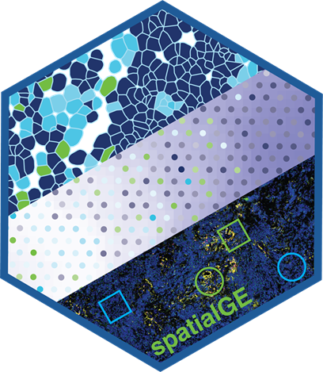
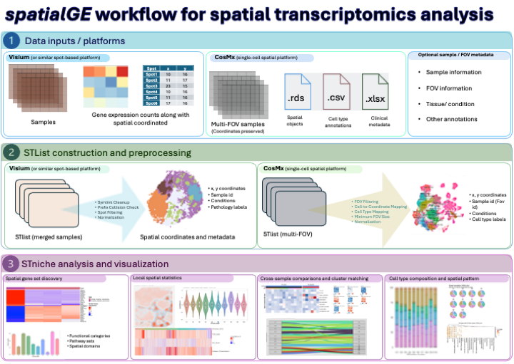

# spatialGE



An R package for visualizing and analyzing spatially-resolved transcriptomics data from spot-based
platforms (e.g., 10X Visium) and imaging-based platforms (e.g., Xenium, CosMx). Data and results
from multiple tissue sections are stored in a single **STlist** (Spatial Transcriptomics List) object.

## Features

- **Visualization:** `STplot`, `gene_interpolation`, `STplot_interpolation` for exploring gene expression in spatial context.
- **Spatial autocorrelation:** `SThet`, `compare_SThet` to quantify spatial uniformity (Moran's I, Geary's C) and relate it to sample metadata.
- **Tissue domain detection:** `STclust` for spatially-informed hierarchical clustering.
- **Gene set enrichment:** `STenrich` to detect gene sets with spatial patterns, optionally within a tissue domain.
- **Spatial gradients:** `STgradient` to find genes whose expression varies with distance to a tissue domain.
- **Differential expression:** `STdiff` for mixed models with spatial covariance, plus non-spatial Wilcoxon and t-tests.
- **Spatial niche detection:** `STniche` to identify tissue niches from the local spatial organization of gene sets, with `plot_stniche` for visualization (see below).

<p align="center">

</p>

## Spatial niche detection with STniche

`STniche` detects niches, local microenvironments where particular cell types and molecular programs
co-occur, in three steps:

1. **Gene set scoring:** each spot or cell receives an activity score for every gene set of interest.
2. **Spatial autocorrelation:** a local Moran's I statistic (reported as a Z-score, Zi) measures whether
   each gene set is spatially concentrated around that location.
3. **Clustering:** Zi profiles are clustered with model-based clustering, and the number of niches is
   chosen by BIC.

It works on spot-based (Visium) and single-cell (CosMx) data. When run on several samples at once, niche
labels (C1, C2, ...) are shared and directly comparable across samples.

```r
library(spatialGE)

# gene_sets: a named list of character vectors, one per gene set
res <- STniche(x = stlist, gene_sets = gene_sets,
               samples = names(stlist@spatial_meta),
               ks = 10, knns = 22, out_i = TRUE, cores = 4)

st <- res[[1]]  # STlist with niche assignments
zi <- res[[2]]  # Local Moran's Z (Zi) matrix
```

`plot_stniche` visualizes the results through its `type` argument:

| `type` | Shows |
|---|---|
| `"clusters"` | Niche map of each sample |
| `"Zi"` | Local Moran's Z of one gene set (requires `zi` and `gene_set`) |
| `"celltype_heatmap"` | Fraction of each niche's cells belonging to each cell type |
| `"celltype_composition"` | Stacked bars of cell-type composition per niche |
| `"multi_sample_alluvial"` | Niche correspondence between samples through shared gene-set programs (requires `zi`) |

```r
plot_stniche(st, type = "clusters", samples = "sample1")
plot_stniche(st, type = "Zi", zi = zi, gene_set = "TLS_core", samples = "sample1")
```

The STniche vignette applies these functions to two case studies: Visium sections from renal cell
carcinoma (GSE175540), where niches are compared against pathologist-annotated tertiary lymphoid
structures, and CosMx clear cell RCC fields of view, where niches are characterized by cell-type
composition and immune signaling in IO-naive and IO-exposed tumors.

## What's new in 2.0.0

**New**

- `STniche` and `plot_stniche` for spatial niche detection on Visium and CosMx data.
- Subset an `STlist` by sample with `x[i]`; `length(x)` now returns the number of samples.
- Seurat v5 support, and `as_Seurat()` for converting back.
- Optional on-disk storage for data larger than memory (`STlist_to_disk()`, `STlist_to_memory()`).
- Parallel processing on Windows.
- Faster and lighter on large datasets: `SThet`, `STgradient`, `filter_data`, and `STdiff` (t-test/Wilcoxon) now scale to Xenium- and CosMx-sized samples.

**Changes that may affect existing code**

- `dim()` on an `STlist` returns `c(n_genes, n_spots)` for a single sample and `NULL` for multiple samples; use `summarize_STlist()` for per-sample dimensions.
- `STlist` objects are validated at construction.
- Unmatched genes, annotations, or domains now raise an error instead of being silently ignored.
- `STenrich()` requires `annot` and `domain` to be supplied together.
- Spots are now ordered deterministically by coordinates.
- In `@gene_meta`, `vst.variance.standardized` now precedes `moran_i` and `geary_c`; select columns by name.

**Fixes**

- `pseudobulk_heatmap()` previously displayed the *least* variable genes. Heatmaps from 1.2.x should be regenerated.
- `STenrich(annot=, domain=)` now works; it failed in 1.2.1 and 1.2.2.

See [NEWS.md](NEWS.md) for the full list of changes.

## Installation

```r
options(timeout = 9999999) # Avoid connection timeouts when downloading from GitHub
devtools::install_github("fridleylab/spatialGE")
```

## Documentation

- Tutorials: https://fridleylab.github.io/spatialGE/
- Source code: https://github.com/FridleyLab/spatialGE
- **[spatialGE-Web](https://spatialge.moffitt.org):** a point-and-click web application for using spatialGE without coding. It supports Visium outputs and csv/tsv expression files paired with coordinate files.

## Citation

If you use spatialGE, please cite:

Ospina, O. E., Wilson, C. M., Soupir, A. C., Berglund, A., Smalley, I., Tsai, K. Y., Fridley, B. L. (2022).
spatialGE: quantification and visualization of the tumor microenvironment heterogeneity using spatial
transcriptomics. *Bioinformatics*, 38, 2645-2647. https://doi.org/10.1093/bioinformatics/btac145

Ospina, O. E., Manjarres-Betancur, R., Gonzalez-Calderon, G., Soupir, A. C., Smalley, I., Tsai, K. Y.,
Markowitz, J., Khaled, M. L., Vallebuona, E., Berglund, A. E., Eschrich, S. A., Yu, X., Fridley, B. L. (2025).
spatialGE is a user-friendly web application that facilitates spatial transcriptomics data analysis.
*Cancer Research*, 85(5), 848-858. https://doi.org/10.1158/0008-5472.CAN-24-2346

When using `STdiff`, please also cite:

Ospina, O. E., Soupir, A. C., Manjarres-Betancur, R., Gonzalez-Calderon, G., Yu, X., Fridley, B. L. (2024).
Differential gene expression analysis of spatial transcriptomic experiments using spatial mixed models.
*Scientific Reports*, 14, 10967. https://doi.org/10.1038/s41598-024-61758-0

<!-- Visitor-counter badge, commented out because R CMD check --as-cran flags its URL
     as possibly invalid. Uncomment to restore.
<p align="center">
<a href="https://clustrmaps.com/site/1bwt8">

</a>
</p>
-->